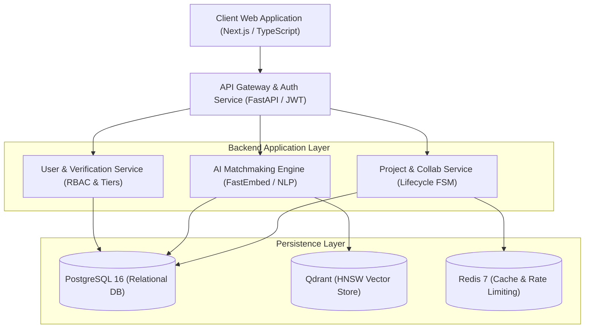

# UniExpert

### AI-Powered Expert Discovery and Academic Collaboration Platform

[](https://app.notion.com/p/3f63c6f2b87f8081bd58fd99ca8f2ca0?source=copy_link)
[](https://github.com/zafor2002/UniExpert)
[](https://github.com/zafor2002/UniExpert)
[](https://github.com/zafor2002/UniExpert)

---

## 📌 Project Overview

**UniExpert** is an intelligent, AI-powered academic discovery and collaboration platform engineered to break down institutional silos in higher education. University students undertaking final-year capstone projects, theses, and innovative research consistently face friction in identifying, evaluating, and contacting specialized researchers, faculty advisors, and industry mentors.

UniExpert replaces rigid keyword directories with a **problem-first discovery engine**:
1. Students submit unstructured, natural-language project statements.
2. The AI inference engine extracts domain classifications and prerequisite skill entities using zero-shot transformers.
3. Candidate experts are retrieved using dense semantic embeddings (Qdrant HNSW vector search).
4. Matches are ranked using a multi-criteria hybrid scoring engine integrating domain relevance, skill overlap, research alignment, credential verification, and calendar availability.
5. Every recommendation provides Explainable AI (XAI) justifications.
6. A set-cover optimizer detects multidisciplinary team skill gaps ($\Delta \mathcal{K}$).
7. Inbound solicitations are mediated through an auditable Finite State Machine (FSM) with anti-burnout faculty quotas.

---

## 🔗 Project Spaces & Notion Integration

| Platform | Resource Link | Description |
| :--- | :--- | :--- |
| **Notion** | [UniExpert Notion Workspace](https://app.notion.com/p/3f63c6f2b87f8081bd58fd99ca8f2ca0?source=copy_link) | Central capstone workspace, task management, sprint logs, and research notes. |
| **GitHub** | [zafor2002/UniExpert](https://github.com/zafor2002/UniExpert) | Official source repository, documentation, LaTeX specifications, and codebase. |

### How to Connect Git & Notion
1. **In Notion:** Open the [UniExpert Notion Page](https://app.notion.com/p/3f63c6f2b87f8081bd58fd99ca8f2ca0?source=copy_link), type `/github`, and choose **GitHub Synced Database** or **Paste as Preview** using `https://github.com/zafor2002/UniExpert`.
2. **In GitHub:** Go to **Settings** $\rightarrow$ **Integrations** or use GitHub Actions to trigger updates in Notion databases whenever commits, PRs, or issues are opened.
3. **Commit Linking:** Tag Notion task IDs in commit messages (e.g., `git commit -m "feat(nlp): add entity extractor #task-id"`).

---

## 👥 Academic Team & Supervision

- **Course:** `SE 331 — Software Engineering Design Capstone Project`
- **Department:** Department of Software Engineering, Faculty of Science & Information Technology
- **Academic Term:** Fall 2026 (October — December 2026, 12 Weeks)
- **Date of Submission:** October 12, 2026

### 👨‍💻 Student Engineering Team
- **Abu Zafor** — Student ID: `232-35-331` — [@zafor2002](https://github.com/zafor2002)
- **Anamul Haque** — Student ID: `232-35-285`

### 👨‍🏫 Faculty Supervision
- **Mr. Md. Shohel Arman** — Assistant Professor, Department of Software Engineering

---

## 📄 Formal Deliverables

| Document | Source File | Compiled Deliverable | Description |
| :--- | :--- | :--- | :--- |
| **Capstone Proposal** | [`uniexpert_proposal.tex`](./uniexpert_proposal.tex) | [**UniExpert_Proposal_Fall2026.pdf**](./UniExpert_Proposal_Fall2026.pdf) | Complete 11-section capstone proposal with mathematical models and architecture. |
| **Software Requirements Specification (SRS)** | [`uniexpert_srs.tex`](./uniexpert_srs.tex) | [**UniExpert_SRS.pdf**](./UniExpert_SRS.pdf) | Formal 24-page IEEE 830 / ISO 29148 specification with 20 requirement cards and RTM. |

---

## 🏛️ System Architecture



---

## 📐 Mathematical Formulation

### 1. Hybrid Multi-Criteria Matchmaking
$$\mathcal{S}(u, e) = w_1 \cdot \mathcal{D}(u, e) + w_2 \cdot \mathcal{K}(u, e) + w_3 \cdot \mathcal{R}(u, e) + w_4 \cdot \mathcal{V}(e) + w_5 \cdot \mathcal{A}(u, e)$$
Where:
- $\mathcal{D}(u, e) \in [0, 1]$: Primary \& secondary domain compatibility.
- $\mathcal{K}(u, e) \in [0, 1]$: Technical skill taxonomy overlap (Jaccard / weighted).
- $\mathcal{R}(u, e) \in [0, 1]$: Semantic cosine similarity between dense embeddings.
- $\mathcal{V}(e) \in [0, 1]$: Multi-tier verified credential weight (Tiers 1--4).
- $\mathcal{A}(u, e) \in [0, 1]$: Availability compatibility and calendar blackout status.

### 2. Team Skill Gap Optimization
$$\Delta \mathcal{K} = \mathcal{K}_u \setminus \bigcup_{e \in \mathcal{M}} \mathcal{K}_e$$
When assembling multi-member advisory panels, the engine minimizes $|\Delta \mathcal{K}|$ by recommending complementary recruits.

---

## 🛠️ LaTeX Compilation

To compile the LaTeX deliverables locally:

```powershell
# Compile the Capstone Proposal
pdflatex -interaction=nonstopmode -jobname=UniExpert_Proposal_Fall2026 uniexpert_proposal.tex
pdflatex -interaction=nonstopmode -jobname=UniExpert_Proposal_Fall2026 uniexpert_proposal.tex

# Compile the Software Requirements Specification (SRS)
pdflatex -interaction=nonstopmode -jobname=UniExpert_SRS uniexpert_srs.tex
pdflatex -interaction=nonstopmode -jobname=UniExpert_SRS uniexpert_srs.tex
```

---

## 📜 License
This project is developed for academic evaluation in **SE 331: Software Engineering Design Capstone Project** at the Department of Software Engineering.
