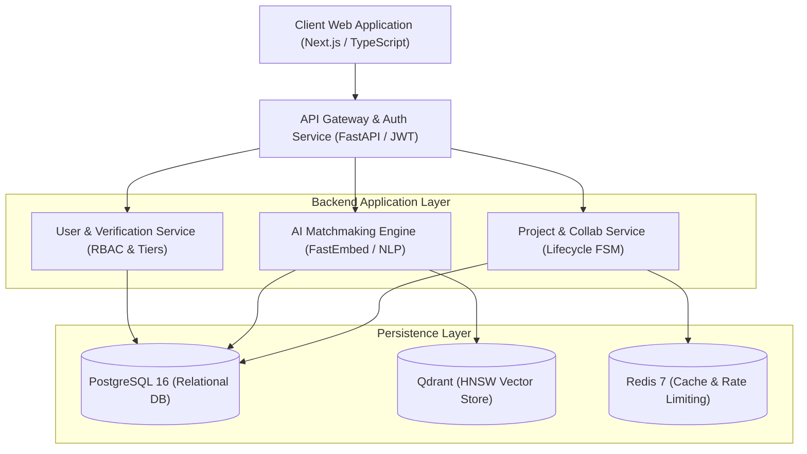

# UniExpert

### AI-Powered Expert Discovery and Academic Collaboration Platform

[](https://app.notion.com/p/3f63c6f2b87f8081bd58fd99ca8f2ca0?source=copy_link)
[](https://github.com/zafor2002/UniExpert)
[](https://github.com/zafor2002/UniExpert)
[](https://github.com/zafor2002/UniExpert)

---

## 📌 Project Overview

**UniExpert** is an intelligent, AI-powered academic discovery and collaboration platform engineered to break down institutional silos in higher education. University students undertaking final-year capstone projects, theses, and innovative research consistently face friction in identifying, evaluating, and contacting specialized researchers, faculty advisors, and industry mentors.

UniExpert replaces rigid keyword directories with a **problem-first discovery engine**:
1. Students submit unstructured, natural-language project statements.
2. The AI inference engine extracts domain classifications and prerequisite skill entities using zero-shot transformers.
3. Candidate experts are retrieved using dense semantic embeddings (Qdrant HNSW vector search).
4. Matches are ranked using a multi-criteria hybrid scoring engine integrating domain relevance, skill overlap, research alignment, credential verification, and calendar availability.
5. Every recommendation provides Explainable AI (XAI) justifications.
6. A set-cover optimizer detects multidisciplinary team skill gaps ($\Delta \mathcal{K}$).
7. Inbound solicitations are mediated through an auditable Finite State Machine (FSM) with anti-burnout faculty quotas.

---

## 🔗 Project Spaces & Notion Integration

| Platform | Resource Link | Description |
| :--- | :--- | :--- |
| **Notion** | [UniExpert Notion Workspace](https://app.notion.com/p/3f63c6f2b87f8081bd58fd99ca8f2ca0?source=copy_link) | Central capstone workspace, task management, sprint logs, and research notes. |
| **GitHub** | [zafor2002/UniExpert](https://github.com/zafor2002/UniExpert) | Official source repository, documentation, LaTeX specifications, and codebase. |

### How to Connect Git & Notion
1. **In Notion:** Open the [UniExpert Notion Page](https://app.notion.com/p/3f63c6f2b87f8081bd58fd99ca8f2ca0?source=copy_link), type `/github`, and choose **GitHub Synced Database** or **Paste as Preview** using `https://github.com/zafor2002/UniExpert`.
2. **In GitHub:** Go to **Settings** $\rightarrow$ **Integrations** or use GitHub Actions to trigger updates in Notion databases whenever commits, PRs, or issues are opened.
3. **Commit Linking:** Tag Notion task IDs in commit messages (e.g., `git commit -m "feat(nlp): add entity extractor #task-id"`).

---

## 👥 Academic Team & Supervision

- **Course:** `SE 331 — Software Engineering Design Capstone Project`
- **Department:** Department of Software Engineering, Faculty of Science & Information Technology
- **Academic Term:** Fall 2026 (October — December 2026, 12 Weeks)
- **Date of Submission:** October 14, 2026

### 👨‍💻 Student Engineering Team
- **Abu Zafor** — Student ID: `232-35-331` — [@zafor2002](https://github.com/zafor2002)
- **Anamul Haque** — Student ID: `232-35-285`

### 👨‍🏫 Faculty Supervision
- **Mr. Md. Shohel Arman** — Assistant Professor, Department of Software Engineering

---

## 📄 Formal Deliverables

| Document | Source File | Compiled Deliverable | Edition | Description |
| :--- | :--- | :--- | :--- | :--- |
| **Capstone Proposal (Full)** | [`uniexpert_proposal.tex`](./uniexpert_proposal.tex) | [**UniExpert_Proposal_Fall2026.pdf**](./UniExpert_Proposal_Fall2026.pdf) | Comprehensive (17 Pages) | Complete 11-section capstone proposal with comprehensive models, work breakdown, and architecture. |
| **Capstone Proposal (Minimalist)** | [`uniexpert_proposal_minimal.tex`](./uniexpert_proposal_minimal.tex) | [**UniExpert_Proposal_Minimal.pdf**](./UniExpert_Proposal_Minimal.pdf) | Minimalist (5 Pages) | High-density 5-page executive proposal with mathematical models, TikZ architecture, tech stack, MoSCoW matrix, and timeline. |
| **Software Requirements Specification (Full)** | [`uniexpert_srs.tex`](./uniexpert_srs.tex) | [**UniExpert_SRS.pdf**](./UniExpert_SRS.pdf) | Comprehensive (24 Pages) | Formal IEEE 830 / ISO 29148 specification with 20 requirement cards, context diagram, ER models, and RTM. |
| **Software Requirements Specification (Minimalist)** | [`uniexpert_srs_minimal.tex`](./uniexpert_srs_minimal.tex) | [**UniExpert_SRS_Minimal.pdf**](./UniExpert_SRS_Minimal.pdf) | Minimalist (8 Pages) | Streamlined 8-page IEEE 830 baseline with minimalist title page, context diagram, consolidated 20-FR matrix, NFR benchmarks, data dictionary, RTM, and committee sign-off. |
| **Capstone Final Documentation (Full)** | [`uniexpert_final_documentation.tex`](./uniexpert_final_documentation.tex) | [**UniExpert_Report.pdf**](./UniExpert_Report.pdf) / [**UniExpert_Documentation.pdf**](./UniExpert_Documentation.pdf) | Publication-Grade (Times New Roman, 64 Pages) | Official Daffodil International University (DIU) Capstone Final Documentation format in Times New Roman (`newtxtext`, `newtxmath`): Chapters 1--5 with Concise Introduction, Objectives, 10 Crisp Key Features, 6 Scenarios, 6 Stakeholders, 5 User Profiles (12-row cards), 10 Scope areas, 5 Feasibility aspects, 5 Block Diagrams, 26 FRs, 21 NFRs (7 categories), Minimalist Zero-Overlap Use Case Diagram (5 Subsystem Packages), 25 Use Case Descriptions (dedicated tables), Zero-Intersection DFD Level-0 \& Level-1, 6 Sequence Diagrams, 6 State Diagrams, 3x3 Topological ERD, and 3-Tier UML Class Diagram. All orphaned pages and empty gaps completely eliminated. |

---

## 💻 Interactive High-Fidelity Web Prototype (React + TypeScript)

A publication-grade, interactive **React 18 + TypeScript + Tailwind CSS** prototype is included in the [`uniexpert-prototype/`](./uniexpert-prototype) directory.

### Quick Start
```bash
# Navigate to prototype folder
cd uniexpert-prototype

# Start Vite dev server (runs on port 5173)
npm run dev
# -> Local: http://localhost:5173/
```

### Full 34-Screen Implementation Matrix:
1. **Public / Identity (Screens 1–4):** Landing Page with problem statement hero, DIU .edu.bd email registration with password strength meter, 24-hr token email verification with expired state, and lockout-protected login with TOTP MFA.
2. **Student Project Lead (Screens 5–18):** Capstone problem formulation (50–5,000 char counter), NLP entity review with confidence bars & importance sliders, Qdrant vector discovery catalog with 38ms simulated latency, Explainable AI (XAI) drawer with 45/30/15/10% mathematical decomposition and radar chart, 3-expert side-by-side comparison matrix, Bioinformatics skill gap analysis ($\Delta\mathcal{K}$), set-cover co-advisor optimizer, FSM proposal modal with 7-day auto-SLA & race condition simulation, request lifecycle stepper with negotiation thread, atomic 30-min office hours consultation booking with `.ics` calendar generation, live WebSocket-style workspace with file attachments, and post-collaboration exit evaluation.
3. **Faculty Advisor (Screens 19–24):** Faculty dashboard with 5-team anti-burnout quota meter, Google Scholar / ORCID automated scraper with multi-step progress & BibTeX/CSV fallback, Tier 1/2/3 progression card, proposal review with auto-status advance & quota decrement, capacity settings with blackout date range picker, and recurring weekly office-hour block manager.
4. **Industry Mentor (Screens 25–26):** Mentor onboarding wizard (3 steps) and practitioner dashboard with evening consultation hours.
5. **Department Coordinator (Screens 27–29):** Department allocation heatmap with 60-second live countdown, faculty verification queue with tier assignment and justification notes, individual quota override panel (+1 limit), and dispute resolution list.
6. **System Administrator (Screens 30–32):** Hierarchical domain taxonomy DAG console with cycle detection, custom tag moderation queue, Qdrant vector embedding re-indexer, RBAC account privilege console, and cluster telemetry dashboard with hardware TOTP-protected admin zone.
7. **Institutional Auditor (Screens 33–34):** Cryptographic SHA-256 Merkle chained audit ledger with live tamper simulator and signed CSV export, plus official BAETE Accreditation Dossier generator with PDF preview and load charts.

---

## 💻 Vue.js Minimalist Prototype

A full-featured, high-fidelity **Vue 3 + Vite + Tailwind CSS** prototype is included in the [`prototype/`](./prototype) directory.

### Quick Start
```bash
# Navigate to prototype folder
cd prototype

# Install dependencies (already prepared)
npm install

# Start Vite dev server
npm run dev
# -> Local: http://localhost:5173/
```

### Minimalist, Role-Based Interface Architecture:
The prototype features an ultra-clean, monochromatic academic layout where navigation and capabilities strictly adapt to the selected role:

1. 🎓 **Student Lead Workspace (`Abu Zafor - 232-35-331`, Team *BioShield AI*):**
   - **AI Matchmaking:** Problem ingestion, zero-shot entity extraction, multi-criteria weight tuning sliders ($w_1, w_2, w_3, w_4$), ranked matches, and Explainable AI (XAI) modal ($S_{\text{final}} = S_{\text{tier}} \cdot \sum w_i S_i$).
   - **Skill Gap Optimizer ($\Delta\mathcal{K}$):** Visual competency readiness bar, deficit detection ($\Delta\mathcal{K} = \mathcal{K}_{\text{project}} \setminus \bigcup \mathcal{K}_m$), and set-cover cross-department co-advisor suggestions.
   - **My Applications (FSM):** 4-stage lifecycle tracking (`DRAFT` $\rightarrow$ `SUBMITTED` $\rightarrow$ `UNDER_REVIEW` $\rightarrow$ `ACCEPTED` / `DECLINED`) and collaborative milestone notes.
   - **Book Office Hours:** Direct atomic reservation of faculty consultation slots with `.ics` calendar sync.

2. 👨‍🏫 **Faculty Advisor Workspace (`Dr. Md. Shohel Arman`):**
   - **Advisory Inbox:** Actionable queue of student proposals with 1-click **Accept** (auto-decrements quota), **Decline with Reason**, or **Request Scope Revision**.
   - **Supervisory Capacity:** Anti-burnout quota meter (max 5 teams/semester cap) and custom 30-min office hours slot manager.
   - **Active Supervised Groups:** Direct management of accepted capstone teams and milestone review tracking.

3. 🏛️ **Department Coordinator Workspace (`Prof. Dr. Syed Akhter Hossain`):**
   - **Faculty Load Heatmap:** Department-wide supervisory load-balancing grid (SWE, CSE, CIS) with overload alerts.
   - **Co-Advisory Endorsements:** Formal review and sign-off queue for cross-departmental supervision agreements.
   - **Allocation Analytics:** Real-time departmental metrics (124 students, 36 teams, 88.9% allocation rate).

4. 👔 **Industry Mentor Workspace (`Engr. Tanvir Ahmed`, Principal AI Architect):**
   - **Mentorship Inquiries:** Evaluation queue for industry co-supervision proposals.
   - **Office Hours & Sync:** Evening/weekend practitioner consultation slots.
   - **Technical Reviews:** Architectural and code quality attestation stamps for student Git repositories.

5. 🔍 **Compliance Auditor Workspace (`DIU Quality Assurance Cell`):**
   - **Cryptographic Audit Ledger:** Append-only SHA-256 Merkle chained event blocks with role and keyword filters.
   - **Accreditation Reports:** One-click official BAETE (Criterion 4 & 5) compliance audit dossier export (CSV).
   - **Merkle Chain Verification:** Live automated hash-chain validation tool.

---

## 🏛️ System Architecture



---

## 📐 Mathematical Formulation

### 1. Hybrid Multi-Criteria Matchmaking
$$\mathcal{S}(u, e) = w_1 \cdot \mathcal{D}(u, e) + w_2 \cdot \mathcal{K}(u, e) + w_3 \cdot \mathcal{R}(u, e) + w_4 \cdot \mathcal{V}(e) + w_5 \cdot \mathcal{A}(u, e)$$
Where:
- $\mathcal{D}(u, e) \in [0, 1]$: Primary \& secondary domain compatibility.
- $\mathcal{K}(u, e) \in [0, 1]$: Technical skill taxonomy overlap (Jaccard / weighted).
- $\mathcal{R}(u, e) \in [0, 1]$: Semantic cosine similarity between dense embeddings.
- $\mathcal{V}(e) \in [0, 1]$: Multi-tier verified credential weight (Tiers 1--4).
- $\mathcal{A}(u, e) \in [0, 1]$: Availability compatibility and calendar blackout status.

### 2. Team Skill Gap Optimization
$$\Delta \mathcal{K} = \mathcal{K}_u \setminus \bigcup_{e \in \mathcal{M}} \mathcal{K}_e$$
When assembling multi-member advisory panels, the engine minimizes $|\Delta \mathcal{K}|$ by recommending complementary recruits.

---

## 🛠️ LaTeX Compilation

To compile the LaTeX deliverables locally:

```powershell
# ==========================================
# Comprehensive Editions
# ==========================================
# Capstone Proposal (Comprehensive, 17 Pages)
pdflatex -interaction=nonstopmode -jobname=UniExpert_Proposal_Fall2026 uniexpert_proposal.tex
pdflatex -interaction=nonstopmode -jobname=UniExpert_Proposal_Fall2026 uniexpert_proposal.tex

# Software Requirements Specification (SRS) (Comprehensive, 24 Pages)
pdflatex -interaction=nonstopmode -jobname=UniExpert_SRS uniexpert_srs.tex
pdflatex -interaction=nonstopmode -jobname=UniExpert_SRS uniexpert_srs.tex

# ==========================================
# Minimalist Editions
# ==========================================
# Capstone Proposal (Minimalist, 5 Pages)
pdflatex -interaction=nonstopmode -jobname=UniExpert_Proposal_Minimal uniexpert_proposal_minimal.tex
pdflatex -interaction=nonstopmode -jobname=UniExpert_Proposal_Minimal uniexpert_proposal_minimal.tex

# Software Requirements Specification (SRS) (Minimalist, 8 Pages)
pdflatex -interaction=nonstopmode -jobname=UniExpert_SRS_Minimal uniexpert_srs_minimal.tex
pdflatex -interaction=nonstopmode -jobname=UniExpert_SRS_Minimal uniexpert_srs_minimal.tex
```

---

## 📜 License
This project is developed for academic evaluation in **SE 331: Software Engineering Design Capstone Project** at the Department of Software Engineering.
