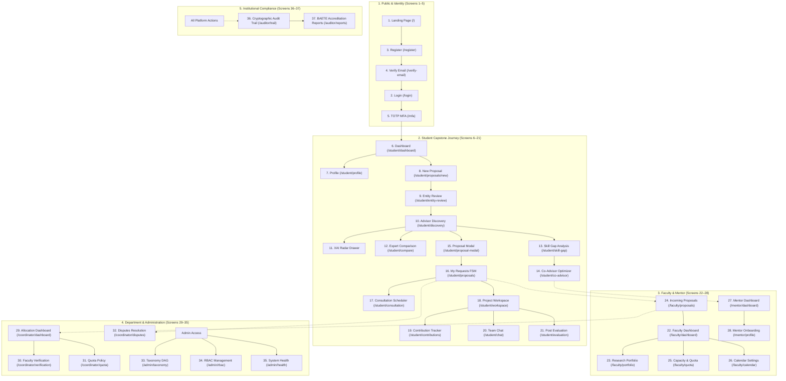

# UniExpert Platform — Complete Screen Architecture & Coverage Specification

> **Platform Version:** 2.0 (High-Fidelity React 18 + TypeScript + Tailwind CSS Prototype)  
> **Total Screen Count:** **37 Dedicated Screens & Modal Views**  
> **Stakeholder Roles Covered:** 7 (Public/Identity, Student Project Lead, Faculty Advisor, Industry Mentor, Department Coordinator, System Administrator, Institutional Auditor)  
> **Accreditation Alignment:** BAETE Criterion 4 & 5 (Outcomes-Based Education), IEEE 830 / ISO 29148  

---

## Executive Summary & Screen Inventory

| Module / Role | Screen Count | Primary Functional Responsibility | Key Technical Standards & Algorithms |
|---|:---:|---|---|
| **1. Public & Identity** | **5** | Authentication, student onboarding, security governance | Domain lock (`.edu.bd`), TOTP MFA, 24-hr token FSM |
| **2. Student Project Lead** | **16** | End-to-end capstone formulation, matching, tracking & defense | Zero-shot NLP, Qdrant Vector Search, XAI Radar, Set-Cover Co-Advisor, Contribution Heatmap |
| **3. Faculty Advisor** | **5** | Mentorship capacity, publication portfolio, request review | Scholar automated ingestion, Anti-burnout quota meter, Atomic slot scheduling |
| **4. Industry Mentor** | **2** | Practitioner co-supervision, code quality attestation | Industry credential verification, Evening/weekend consultation windows |
| **5. Department Coordinator** | **4** | Department-wide load balancing, faculty tiers, arbitration | 3-tier accreditation matrix, Load heatmap, Dispute mediation audit |
| **6. System Administrator** | **3** | Taxonomy ontology governance, RBAC privileges, telemetry | Cycle-detected Taxonomy DAG, Role-based security, Vector latency metrics |
| **7. Institutional Auditor** | **2** | Cryptographic audit trail, accreditation dossiers | SHA-256 append-only Merkle chain, BAETE Criterion 4/5 automated reports |
| **Total Platform Screens** | **37** | **Complete Academic Capstone & Accreditation Suite** | **Full Lifecyle Traceability** |

---

## Module 1: Public & Identity Management (5 Screens)

```
[Landing Page] ──► [Registration] ──► [Email Verification] ──► [Login] ──► [TOTP 2FA]
```

### 1. Landing Page
* **Route:** `/`
* **File:** [`uniexpert-prototype/src/pages/public/LandingPage.tsx`](file:///e:/SE%20331%20caostone%20project/uniexpert-prototype/src/pages/public/LandingPage.tsx)
* **Part Covered:** **Institutional Gateway & Value Proposition.**
  * Introduces the problem-first AI matching model versus outdated keyword directories.
  * Live metrics counter (verified faculty, student teams, average matching latency: 38ms).
  * Direct portals for Students, Faculty Advisors, and Institutional Administrators.
  * BAETE Criterion 4 & 5 compliance accreditation badge.

### 2. User Login
* **Route:** `/login`
* **File:** [`uniexpert-prototype/src/pages/public/LoginPage.tsx`](file:///e:/SE%20331%20caostone%20project/uniexpert-prototype/src/pages/public/LoginPage.tsx)
* **Part Covered:** **Secure Authentication & Brute-Force Safeguard.**
  * Email and password credential validation.
  * Client-side attempt rate-limiting (lockout simulated after 5 failed attempts).
  * Role detection and redirection engine into the respective workspace.

### 3. Student & Faculty Registration
* **Route:** `/register`
* **File:** [`uniexpert-prototype/src/pages/public/RegisterPage.tsx`](file:///e:/SE%20331%20caostone%20project/uniexpert-prototype/src/pages/public/RegisterPage.tsx)
* **Part Covered:** **Academic Domain Whitelist & Identity Verification.**
  * Strict institutional domain lock (e.g. `@diu.edu.bd`).
  * Live password entropy meter (length, symbol, digit, mixed-case validation).
  * Initial department affiliation (Software Engineering, CSE, CIS) and Student ID / Faculty Employee ID capture.

### 4. Email Verification
* **Route:** `/verify-email`
* **File:** [`uniexpert-prototype/src/pages/public/EmailVerifyPage.tsx`](file:///e:/SE%20331%20caostone%20project/uniexpert-prototype/src/pages/public/EmailVerifyPage.tsx)
* **Part Covered:** **Cryptographic 24-Hour Token Validation.**
  * Simulates verification link parsing with cryptographic token checksum.
  * Handles expired token states with 1-click resend capability.
  * Prevents unverified accounts from entering proposal matching queues.

### 5. Multi-Factor Authentication (MFA)
* **Route:** `/mfa`
* **File:** [`uniexpert-prototype/src/pages/public/EmailVerifyPage.tsx`](file:///e:/SE%20331%20caostone%20project/uniexpert-prototype/src/pages/public/EmailVerifyPage.tsx)
* **Part Covered:** **TOTP Hardware/App Security Enforcement.**
  * 6-digit Time-based One-Time Password (TOTP) input for Google Authenticator / Microsoft Authenticator.
  * Enforced for elevated roles (Coordinators, System Admins, Compliance Auditors).

---

## Module 2: Student Project Lead Workspace (16 Screens)

### 6. Student Dashboard
* **Route:** `/student/dashboard`
* **File:** [`uniexpert-prototype/src/pages/student/StudentDashboard.tsx`](file:///e:/SE%20331%20caostone%20project/uniexpert-prototype/src/pages/student/StudentDashboard.tsx)
* **Part Covered:** **Central Project Command Center.**
  * Hero banner with countdown to the official Final Defense date.
  * Interactive 5-stage Capstone Lifecycle Stepper:
    1. Problem Formulation $\rightarrow$ 2. Advisor Matching $\rightarrow$ 3. Active Supervision $\rightarrow$ 4. Defense Ready $\rightarrow$ 5. Completed.
  * Quick metrics: match readiness, proposal status, active consultation countdown.

### 7. Student Academic Profile
* **Route:** `/student/profile`
* **File:** [`uniexpert-prototype/src/pages/student/StudentProfile.tsx`](file:///e:/SE%20331%20caostone%20project/uniexpert-prototype/src/pages/student/StudentProfile.tsx)
* **Part Covered:** **Academic Identity & Competency Portfolio.**
  * Batch, section, CGPA, completed prerequisite courses (SE 311, SE 312).
  * Verified technical skills chips (e.g., TinyML, React, IoT, Python).
  * Verified GitHub repository and LinkedIn profile integration.
  * Overall profile completeness score ring.

### 8. New Proposal & Problem Formulation
* **Route:** `/student/proposals/new`
* **File:** [`uniexpert-prototype/src/pages/student/NewProposal.tsx`](file:///e:/SE%20331%20caostone%20project/uniexpert-prototype/src/pages/student/NewProposal.tsx)
* **Part Covered:** **Natural Language Ingestion Engine.**
  * Comprehensive project title and problem statement input (50 to 5,000 chars with live counter).
  * Target platform and methodology selections (Embedded, Web, Cloud, ML).
  * Proposed technology stack tags.
  * Instant trigger into Zero-Shot NLP entity extraction.

### 9. NLP Entity Extraction Review
* **Route:** `/student/entity-review`
* **File:** [`uniexpert-prototype/src/pages/student/EntityReview.tsx`](file:///e:/SE%20331%20caostone%20project/uniexpert-prototype/src/pages/student/EntityReview.tsx)
* **Part Covered:** **Human-in-the-Loop Semantic Tuning.**
  * Visualizes the AI's parsed research domains (confidence percentages).
  * Extracted core competencies with importance weight tuning sliders ($0.0 - 1.0$).
  * Allows students to add missing keywords before vector matching begins.

### 10. Semantic Advisor Discovery Catalog
* **Route:** `/student/discovery`
* **File:** [`uniexpert-prototype/src/pages/student/AdvisorDiscovery.tsx`](file:///e:/SE%20331%20caostone%20project/uniexpert-prototype/src/pages/student/AdvisorDiscovery.tsx)
* **Part Covered:** **Qdrant Vector Hybrid Discovery Engine.**
  * Simulated 38ms vector cosine similarity ranking over faculty publications.
  * Multi-factor scoring ($S_{\text{final}}$): Semantic fit (45%), Publication citations (30%), Supervisory capacity (15%), Co-advisory fit (10%).
  * Real-time search filters: Department, Verification Tier (Tier 1/2/3), Availability status.
  * 1-click access to Compare, XAI breakdown, and Proposal dispatch.

### 11. Explainable AI (XAI) Match Breakdown
* **Route:** Modal / Drawer on `/student/discovery`
* **File:** [`uniexpert-prototype/src/pages/student/XAIDrawer.tsx`](file:///e:/SE%20331%20caostone%20project/uniexpert-prototype/src/pages/student/XAIDrawer.tsx)
* **Part Covered:** **Algorithmic Transparency & Fairness.**
  * 6-axis Radar Chart comparing Student Project Requirements vs. Faculty Expertise.
  * Exact mathematical decomposition of the match score:
    $$S_{\text{final}} = w_1 \cdot S_{\text{sem}} + w_2 \cdot S_{\text{pub}} + w_3 \cdot S_{\text{load}} + w_4 \cdot S_{\text{coadv}}$$
  * Transparent explanation of why an expert was or was not ranked #1.

### 12. 3-Expert Comparison Matrix
* **Route:** `/student/compare`
* **File:** [`uniexpert-prototype/src/pages/student/ExpertComparison.tsx`](file:///e:/SE%20331%20caostone%20project/uniexpert-prototype/src/pages/student/ExpertComparison.tsx)
* **Part Covered:** **Side-by-Side Evaluation Matrix.**
  * Compares up to 3 faculty candidates simultaneously.
  * Compares h-index, verified publications, active group load, available consultation slots, and domain overlap.
  * Highlights the best fit across each specific category.

### 13. Skill Gap Analysis
* **Route:** `/student/skill-gap`
* **File:** [`uniexpert-prototype/src/pages/student/SkillGapAnalysis.tsx`](file:///e:/SE%20331%20caostone%20project/uniexpert-prototype/src/pages/student/SkillGapAnalysis.tsx)
* **Part Covered:** **Deficit Identification ($\Delta\mathcal{K}$).**
  * Computes the mathematical gap between student knowledge and project demands:
    $$\Delta\mathcal{K} = \mathcal{K}_{\text{project}} \setminus (\mathcal{K}_{\text{students}} \cup \mathcal{K}_{\text{advisor}})$$
  * Categorizes skills into: *Matched*, *Missing (Critical)*, and *Tentative*.
  * Generates recommended remedial coursework and co-advisory bridge suggestions.

### 14. Co-Advisor Optimizer
* **Route:** `/student/co-advisor`
* **File:** [`uniexpert-prototype/src/pages/student/CoAdvisorOptimizer.tsx`](file:///e:/SE%20331%20caostone%20project/uniexpert-prototype/src/pages/student/CoAdvisorOptimizer.tsx)
* **Part Covered:** **Set-Cover Co-Supervision Optimization.**
  * Solves the minimum set-cover problem to cover 100% of the project's domain requirements.
  * Evaluates inter-departmental faculty (e.g. Electrical Engineering + Software Engineering) or Industry Practitioners.
  * Calculates coverage gain percentages (e.g., "+35% coverage boost with Dr. Arman").

### 15. Proposal Modal (Submission & SLA)
* **Route:** `/student/proposal-modal`
* **File:** [`uniexpert-prototype/src/pages/student/ProposalModal.tsx`](file:///e:/SE%20331%20caostone%20project/uniexpert-prototype/src/pages/student/ProposalModal.tsx)
* **Part Covered:** **Formal Dispatch & Race-Condition Prevention.**
  * Selects primary advisor and optional co-advisor.
  * Outlines 4 capstone milestone commitments.
  * Displays 7-day auto-response Service Level Agreement (SLA).
  * Optimistic concurrency checks to prevent multi-team slot collision.

### 16. My Requests (FSM Application Tracker)
* **Route:** `/student/proposals` (or `/student/requests`)
* **File:** [`uniexpert-prototype/src/pages/student/MyRequests.tsx`](file:///e:/SE%20331%20caostone%20project/uniexpert-prototype/src/pages/student/MyRequests.tsx)
* **Part Covered:** **Finite State Machine (FSM) Lifecycle Tracker.**
  * Visualizes the status of all submitted proposals:
    $$\text{DRAFT} \longrightarrow \text{SUBMITTED} \longrightarrow \text{UNDER\_REVIEW} \longrightarrow \text{ACCEPTED} / \text{DECLINED}$$
  * Interactive negotiation thread for scope revision requests.
  * 1-click dispute escalation for un-reviewed proposals exceeding the 7-day SLA.

### 17. Consultation Scheduler
* **Route:** `/student/consultation`
* **File:** [`uniexpert-prototype/src/pages/student/ConsultationScheduler.tsx`](file:///e:/SE%20331%20caostone%20project/uniexpert-prototype/src/pages/student/ConsultationScheduler.tsx)
* **Part Covered:** **Atomic Office Hours Reservation.**
  * Interactive weekly calendar showing available 30-minute faculty consultation slots.
  * Form for meeting agenda and pre-consultation artifacts.
  * Auto-generates standard `.ics` calendar invitation file for Google Calendar / Outlook.

### 18. Project Workspace
* **Route:** `/student/workspace`
* **File:** [`uniexpert-prototype/src/pages/student/ProjectWorkspace.tsx`](file:///e:/SE%20331%20caostone%20project/uniexpert-prototype/src/pages/student/ProjectWorkspace.tsx)
* **Part Covered:** **Active Supervision Collaboration Hub.**
  * Stage 3 active project tracking (Group #32, *EdgeShield AI*).
  * Milestone deliverable checklists (SRS, Prototype, Architecture, Final Report).
  * Artifact file repository with size validation (25 MB max per file).
  * Historical archive of supervisor consultation directives and notes.

### 19. Individual Contribution Tracker
* **Route:** `/student/contributions`
* **File:** [`uniexpert-prototype/src/pages/student/ContributionTracker.tsx`](file:///e:/SE%20331%20caostone%20project/uniexpert-prototype/src/pages/student/ContributionTracker.tsx)
* **Part Covered:** **Contribution Evidence & Heatmap (BAETE Criterion 4 & 5).**
  * 10-week contribution density heatmap (GitHub style).
  * Member leaderboard with points ranking and commit / task breakdown.
  * Filterable contribution activity feed (Commits, Tasks, Code Reviews, Reports).
  * Individual accountability attestation for capstone defense panels.

### 20. In-App Team Chat
* **Route:** `/student/chat`
* **File:** [`uniexpert-prototype/src/pages/student/TeamChat.tsx`](file:///e:/SE%20331%20caostone%20project/uniexpert-prototype/src/pages/student/TeamChat.tsx)
* **Part Covered:** **Real-Time Group Communication.**
  * Multi-channel structure (`#general`, `#dev`, `#ml-models`, `#meetings`).
  * Live online presence indicators for team members and supervisors.
  * Message grouping, pinned announcements, emoji reactions, and read receipts.
  * Contrast-optimized, distraction-free minimalist interface.

### 21. Post-Collaboration Exit Evaluation
* **Route:** `/student/evaluation`
* **File:** [`uniexpert-prototype/src/pages/student/PostEvaluation.tsx`](file:///e:/SE%20331%20caostone%20project/uniexpert-prototype/src/pages/student/PostEvaluation.tsx)
* **Part Covered:** **Double-Blind Quality Assurance.**
  * Likert-scale (1–5 stars) evaluation of supervisory responsiveness, technical guidance, and defense readiness.
  * Anonymous qualitative feedback submission.
  * Informs the Department Coordinator's annual faculty mentorship evaluation.

---

## Module 3: Faculty Advisor Workspace (5 Screens)

### 22. Faculty Dashboard
* **Route:** `/faculty/dashboard`
* **File:** [`uniexpert-prototype/src/pages/faculty/FacultyDashboard.tsx`](file:///e:/SE%20331%20caostone%20project/uniexpert-prototype/src/pages/faculty/FacultyDashboard.tsx)
* **Part Covered:** **Advisor Operational Center.**
  * Current active capstone groups vs. maximum capacity quota.
  * Incoming pending student proposal queue with 7-day countdown badges.
  * Today's consultation schedule.
  * Verified Tier badge (Tier 1 Professor / Tier 2 Associate / Tier 3 Assistant).

### 23. Research Portfolio & Publication Ingestion
* **Route:** `/faculty/portfolio`
* **File:** [`uniexpert-prototype/src/pages/faculty/ResearchPortfolio.tsx`](file:///e:/SE%20331%20caostone%20project/uniexpert-prototype/src/pages/faculty/ResearchPortfolio.tsx)
* **Part Covered:** **Automated Scholar Profiling.**
  * Automated Google Scholar / ORCID publication scraper with multi-step progress bar.
  * BibTeX and CSV upload fallbacks.
  * Extracted taxonomy tags for vector semantic embedding.
  * Verified publication list with citation metrics and publication years.

### 24. Incoming Proposals Review
* **Route:** `/faculty/proposals`
* **File:** [`uniexpert-prototype/src/pages/faculty/IncomingProposals.tsx`](file:///e:/SE%20331%20caostone%20project/uniexpert-prototype/src/pages/faculty/IncomingProposals.tsx)
* **Part Covered:** **Proposal Evaluation Queue.**
  * 1-click **Accept** (automatically decrements available capacity quota and moves group to Active Supervision).
  * **Decline with Reason** (returns proposal to student with constructive feedback).
  * **Request Scope Revision** (opens in-app negotiation thread).

### 25. Capacity & Anti-Burnout Quota Policy
* **Route:** `/faculty/quota` (or `/faculty/capacity`)
* **File:** [`uniexpert-prototype/src/pages/faculty/CapacitySettings.tsx`](file:///e:/SE%20331%20caostone%20project/uniexpert-prototype/src/pages/faculty/CapacitySettings.tsx)
* **Part Covered:** **Supervisory Workload Protection.**
  * Quota stepper (1–10 groups allowed per semester).
  * Prevents reducing quota below the count of currently accepted groups.
  * Live availability state preview: Available (≥2), Near Quota (1), Quota Full (0), Blackout.
  * Blackout date range picker for conference attendance, research leave, or sabbatical.

### 26. Calendar & Consultation Settings
* **Route:** `/faculty/calendar`
* **File:** [`uniexpert-prototype/src/pages/faculty/CalendarSettings.tsx`](file:///e:/SE%20331%20caostone%20project/uniexpert-prototype/src/pages/faculty/CalendarSettings.tsx)
* **Part Covered:** **Office Hours Availability Configuration.**
  * Weekly recurring 30-minute consultation slot manager.
  * Physical office location (e.g. Room 602) or Google Meet link assignment.
  * Buffer time and automated reservation confirmation toggles.

---

## Module 4: Industry Mentor Workspace (2 Screens)

### 27. Mentor Dashboard
* **Route:** `/mentor/dashboard` (or `/mentor/requests`)
* **File:** [`uniexpert-prototype/src/pages/mentor/MentorDashboard.tsx`](file:///e:/SE%20331%20caostone%20project/uniexpert-prototype/src/pages/mentor/MentorDashboard.tsx)
* **Part Covered:** **Practitioner Advisory Management.**
  * Co-supervised industry capstone projects.
  * Evening consultation booking schedule.
  * Technical architectural review queue and repository attestation stamps.

### 28. Mentor Onboarding & Profile
* **Route:** `/mentor/profile` (or `/mentor/onboarding`)
* **File:** [`uniexpert-prototype/src/pages/mentor/MentorOnboarding.tsx`](file:///e:/SE%20331%20caostone%20project/uniexpert-prototype/src/pages/mentor/MentorOnboarding.tsx)
* **Part Covered:** **Corporate Mentor Vetting.**
  * 3-step onboarding wizard:
    1. Professional credentials (Company, Title, Years of Experience).
    2. Specialized industry domain tags (e.g., FinTech, Edge AI, Cloud Ops).
    3. Institutional NDA and IP policy confirmation.

---

## Module 5: Department Coordinator Portal (4 Screens)

### 29. Allocation Dashboard
* **Route:** `/coordinator/dashboard`
* **File:** [`uniexpert-prototype/src/pages/coordinator/AllocationDashboard.tsx`](file:///e:/SE%20331%20caostone%20project/uniexpert-prototype/src/pages/coordinator/AllocationDashboard.tsx)
* **Part Covered:** **Departmental Load-Balancing Grid.**
  * Heatmap across Software Engineering, Computer Science, and CIS faculty.
  * Overload alerts for professors approaching maximum capacity.
  * Department allocation rate statistics (e.g., 36 teams, 88.9% allocated).
  * 60-second live deadline countdown clock.

### 30. Faculty Verification Queue
* **Route:** `/coordinator/verification`
* **File:** [`uniexpert-prototype/src/pages/coordinator/FacultyVerification.tsx`](file:///e:/SE%20331%20caostone%20project/uniexpert-prototype/src/pages/coordinator/FacultyVerification.tsx)
* **Part Covered:** **Academic Accreditation Governance.**
  * Verifies faculty profiles against university records and external databases.
  * Assigns institutional tiers (Tier 1: PhD + high citation; Tier 2: Assistant Prof; Tier 3: Lecturer).
  * Tier multipliers feed directly into the matching algorithm.

### 31. Quota Policy Overrides
* **Route:** `/coordinator/quota`
* **File:** [`uniexpert-prototype/src/pages/coordinator/QuotaPolicy.tsx`](file:///e:/SE%20331%20caostone%20project/uniexpert-prototype/src/pages/coordinator/QuotaPolicy.tsx)
* **Part Covered:** **Exceptional Capacity Administration.**
  * Emergency departmental +1 override capability for high-demand specialists.
  * Cross-departmental co-supervision quota balancing.
  * Departmental cap adjustment policies.

### 32. Dispute Resolution & Reassignment
* **Route:** `/coordinator/disputes`
* **File:** [`uniexpert-prototype/src/pages/coordinator/DisputesResolution.tsx`](file:///e:/SE%20331%20caostone%20project/uniexpert-prototype/src/pages/coordinator/DisputesResolution.tsx)
* **Part Covered:** **Academic Mediation & Arbitration.**
  * Handles student escalations for unresponsive advisors (exceeded 7-day SLA).
  * Resolves project scope deadlocks between co-advisors.
  * Facilitates seamless reassignment of capstone groups with audit log preservation.

---

## Module 6: System Administrator Console (3 Screens)

### 33. Taxonomy DAG Console
* **Route:** `/admin/taxonomy`
* **File:** [`uniexpert-prototype/src/pages/admin/TaxonomyConsole.tsx`](file:///e:/SE%20331%20caostone%20project/uniexpert-prototype/src/pages/admin/TaxonomyConsole.tsx)
* **Part Covered:** **Knowledge Graph & Ontology Management.**
  * Interactive Directed Acyclic Graph (DAG) visualizer for research fields.
  * Cycle detection algorithms ensuring no recursive taxonomy loops.
  * Moderation queue for custom technical tags submitted by students.

### 34. RBAC Management & User Privileges
* **Route:** `/admin/rbac`
* **File:** [`uniexpert-prototype/src/pages/admin/RBACManagement.tsx`](file:///e:/SE%20331%20caostone%20project/uniexpert-prototype/src/pages/admin/RBACManagement.tsx)
* **Part Covered:** **Role-Based Access Control Governance.**
  * User provisioning, role switching, and privilege matrix.
  * Account suspension switches for graduated students or departed faculty.
  * MFA enforcement policy controls.

### 35. System Health & Search Cluster Telemetry
* **Route:** `/admin/health`
* **File:** [`uniexpert-prototype/src/pages/admin/SystemHealth.tsx`](file:///e:/SE%20331%20caostone%20project/uniexpert-prototype/src/pages/admin/SystemHealth.tsx)
* **Part Covered:** **Infrastructure & Vector Search Telemetry.**
  * Qdrant vector database query latency monitor (averaging 38ms).
  * Background embedding sync worker health.
  * PostgreSQL connection pool utilization, CPU load, and hardware TOTP admin zone.

---

## Module 7: Institutional Auditor & Compliance (2 Screens)

### 36. Cryptographic Audit Trail
* **Route:** `/auditor/trail`
* **File:** [`uniexpert-prototype/src/pages/auditor/AuditTrail.tsx`](file:///e:/SE%20331%20caostone%20project/uniexpert-prototype/src/pages/auditor/AuditTrail.tsx)
* **Part Covered:** **Append-Only Merkle Audit Ledger.**
  * Immutable SHA-256 chained transaction blocks for every proposal, acceptance, quota override, and dispute.
  * Live tamper simulator demonstrating Merkle root hash invalidation if any database row is altered.
  * Cryptographically signed CSV export for regulatory inspectors.

### 37. Accreditation Reports & Dossier Export
* **Route:** `/auditor/reports`
* **File:** [`uniexpert-prototype/src/pages/auditor/AccreditationReports.tsx`](file:///e:/SE%20331%20caostone%20project/uniexpert-prototype/src/pages/auditor/AccreditationReports.tsx)
* **Part Covered:** **BAETE Criterion 4 & 5 Formal Dossier.**
  * Automated generation of official accreditation dossiers.
  * Proves non-discriminatory, merit-based, and capacity-safe advisor distribution.
  * Generates load charts, skill coverage metrics, and committee sign-off tables.

---

## Complete System Architecture Diagram



---

## Technical Specifications Summary

* **Frontend Framework:** React 18.3.1 with TypeScript 5.8
* **Build Tool:** Vite 8.3.8 (Rolldown production bundler)
* **Styling Engine:** Tailwind CSS 3.4 with accessible contrast tokens:
  * Primary Action: `#4D90F0` (High-contrast Vivid Blue, white text)
  * Background Main: `#EDF2FB`
  * Text Primary: `#0F172A` (Slate 900, AA/AAA contrast compliant)
  * Text Secondary: `#334155` (Slate 700)
  * Accent Success: `#34C99A` (Vivid Mint)
* **Iconography:** Lucide React (feather-compatible, vector-crisp)
* **Chart# If you ever need to restart:
run_backend.bats & Visualizations:** Recharts (Radar, Area, Bar) + SVG Heatmaps
