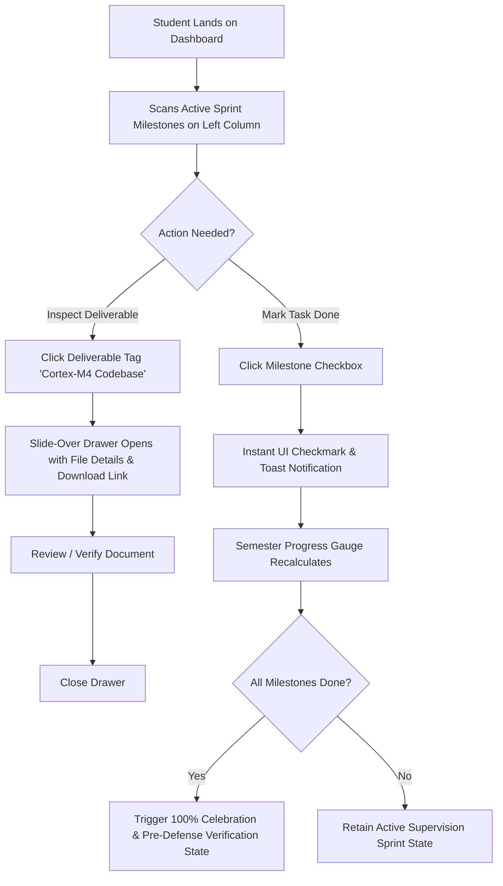
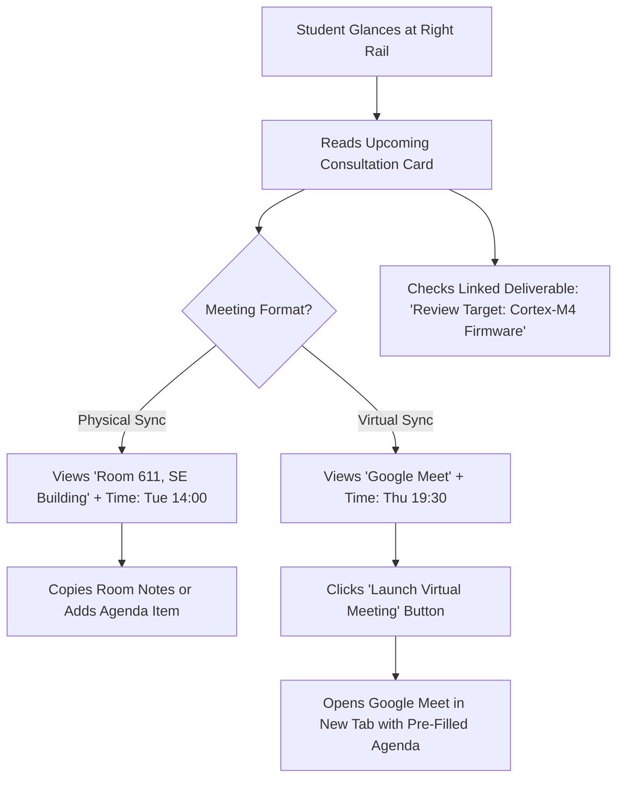
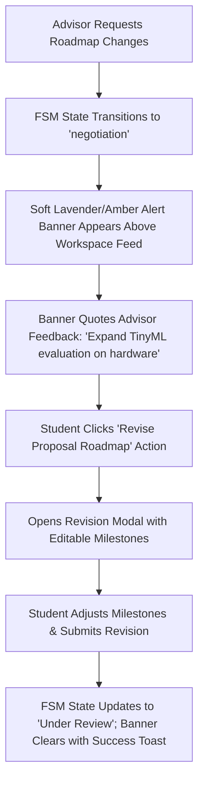

# UniExpert: Student Dashboard — UX Brief

## 1. Problem Framing
- **Problem Statement:** A final-year software engineering student lead needs a way to seamlessly orchestrate daily capstone milestone deliverables, weekly supervisor consultations, and team task readiness in one unified dashboard because fragmented communication channels and unclear progress states risk advisor friction and BAETE accreditation delays.
- **Primary User:** Abu Zafor, Student Project Lead (DIU Department of Software Engineering, Batch 41, Section A).
- **Context:** Managing a complex technical capstone (Autonomous Edge-AI Healthcare Monitoring via BLE 5.0 Sensor Fusion & TinyML ECG Anomaly Detection) across a 120-day semester cycle leading to a December 20, 2026 defense window.

---

## 2. Concept Exploration & Decision Log

### Explored Concepts

#### Concept A: The Asymmetric Execution Cockpit (Workspace-First) — [CHOSEN]
- **Mental Model:** Flight deck / Issue tracker for the capstone sprint.
- **Structure:** 2-column asymmetric grid (8-col main operational feed + 4-col persistent utility rail).
- **Strengths:** 1-click milestone execution, slide-over deliverable verification, persistent countdown and meeting logistics in view.
- **Hybrid Addition:** Integrated Concept C's linked consultation deliverable badge directly into the consultation card (*"Review Target: Cortex-M4 Firmware"*).

#### Concept B: The Chronological Capstone Journey (Timeline-First) — [REJECTED]
- **Mental Model:** Longitudinal interactive semester roadmap.
- **Why It Lost:** Required excessive scrolling on Day 100 to locate active tasks; secondary utilities competed for timeline space; daily operational urgency was diluted.

#### Concept C: The Advisory & Governance Hub (Meeting & Feedback-First) — [REJECTED]
- **Mental Model:** 1:1 meeting workspace with supervisor.
- **Why It Lost:** Underrepresented independent technical development tasks between bi-weekly meetings; felt stalled during periods without scheduled consultations.

---

## 3. User Journey Map
```
┌─────────────────┬────────────────────┬─────────────────────────────┬───────────────────────────────────┐
│ Stage           │ 1. Setup (Day 1)   │ 2. Negotiation (Week 2)     │ 3. Active Sprint (Days 30–100)    │
├─────────────────┼────────────────────┼─────────────────────────────┼───────────────────────────────────┤
│ User Goal       │ Formulate problem  │ Agree on roadmap with lead  │ Execute deliverables & prep for   │
│                 │ & discover advisor │ advisor (Dr. Farhana)       │ weekly supervisory reviews        │
├─────────────────┼────────────────────┼─────────────────────────────┼───────────────────────────────────┤
│ Primary Actions │ Reads onboarding   │ Monitors FSM stepper;       │ Checks defense countdown (38d);   │
│                 │ banner; inputs NLP │ receives negotiation quote; │ previews deliverable in drawer;   │
│                 │ problem statement  │ resubmits revised roadmap   │ toggles milestone task complete   │
├─────────────────┼────────────────────┼─────────────────────────────┼───────────────────────────────────┤
│ Emotional Arc   │ Overwhelmed        │ Anxious about 7-day SLA     │ In control, clear momentum        │
├─────────────────┼────────────────────┼─────────────────────────────┼───────────────────────────────────┤
│ Pain Points     │ Faculty bandwidth  │ Ambiguous email chains;     │ Forgetting meeting room numbers;  │
│                 │ is opaque          │ losing feedback history     │ misplacing latest document drafts │
├─────────────────┼────────────────────┼─────────────────────────────┼───────────────────────────────────┤
│ UX Solution     │ Zero-shot AI match │ Prominent inline alert with │ Asymmetric 8/4 grid: workspace    │
│                 │ & bandwidth meters │ 1-click roadmap revision    │ on left, persistent sync on right │
└─────────────────┴────────────────────┴─────────────────────────────┴───────────────────────────────────┘
```

---

## 4. User Flows

### Flow 1: Daily Milestone Task Completion & Deliverable Preview


### Flow 2: Upcoming Supervisory Consultation Preparation


### Flow 3: FSM Proposal Negotiation Feedback Loop


---

## 5. Information Architecture & Screen Inventory

### Screen Hierarchy
1. **Minimal Profile Header:** Avatar, student name, student ID (`232-35-331`), cohort (`Batch 41`), BAETE Criterion 4 & 5 Eligible badge.
2. **5-Stage Capstone Lifecycle Stepper:** Problem Formulation $\rightarrow$ Advisor Matching $\rightarrow$ Active Supervision $\rightarrow$ Defense Ready $\rightarrow$ Completed.
3. **4-Card KPI Telemetry Row:** Lifecycle Stage (3 of 5), Primary Advisor Match (94%), Team Skill Coverage (100%), Final Defense Window (38 Days).
4. **Asymmetric 2-Column Grid (8 / 4 Split):**
   - **Left Column (8 cols):**
     - Inline FSM Negotiation Alert Banner (Conditional)
     - Active Capstone Showcase Card (Milestone Checklist, Progress Gauge, Deliverable Drawer Triggers)
     - Quick Project Navigation Actions (Co-Advisor Optimizer, Skill Gap, Full Workspace)
   - **Right Column (4 cols):**
     - Standalone Final Defense Countdown Hero Card (Hero digits, timeline bar, target Dec 20)
     - Upcoming Supervisory Consultations Card (Room 611, Google Meet, Linked Deliverable)
     - Capstone Governance & Quick Resources Card (BAETE Checklist, Institutional Guidelines)

---

## 6. Hero Screen
- **The Hero Screen is:** The **Active Capstone Workspace Showcase (`/student`) in Active Supervision State**.
- **Rationale:** It serves as the daily operational center for the capstone team where deliverables are verified, milestones are cleared, and progress toward BAETE Criteria 4 & 5 is calculated.

---

## 7. UX Principles
1. **Information at a Glance:** Crucial logistics (room numbers, meeting times, defense countdown) must be legible within 3 seconds of page load.
2. **Context Over Redirection:** Deliverable previews open in an accessible slide-over drawer; proposal revisions open in an inline modal without causing a full-page context switch.
3. **Calm Academic Reassurance:** High-stakes capstone deadlines are mediated by eye-friendly soft pastels (`#F4F8FF`, `#FFFFFF`, `#8AB4F8`) and positive mint indicators (`#D1FAE5`).
4. **Transparent Governance:** Every cleared milestone visibly demonstrates progression toward BAETE Criteria 4 & 5 compliance.

